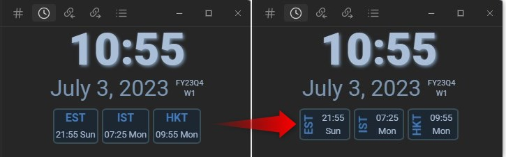

# Tokei (Japanese for "clock")

Tokei is a clock plugin for [Obsidian](https://obsidian.md).

## Alternative Style

- An alternative style is included as a snippet. You can experiment with your own snippets using the provided CSS class for all visible items.

# Manual Installation

To manually install the plugin, follow these steps:

1. Copy `main.js`, `styles.css`, and `manifest.json` to your Obsidian vault's plugin directory: `VaultFolder/.obsidian/plugins/Tokei/`.
2. Optional: Copy `Tokei - compact.css` to your snippet directory.

# Usage

1. After enabling the plugin, you won't see anything initially. To open Tokei, use the "Control/Command + P" shortcut and type "Tokei" and then select the **Tokei: Open** command.
2. Drag the Tokei icon to your preferred location.
3. Customize the settings as needed.
4. If you want to modify the layout and color schemes, take a look at `styles.css` and create your own snippet to change the colors and layout.
5. When adding timezones, press Enter after each name or offset entry.
6. Offset field accepts either a numeric UTC offset (e.g., 0, +1, -5, +5.5) or an IANA timezone ID (e.g., America/New_York, Europe/London). Using IANA zones automatically handles DST. The field also provides smart suggestions from known timezones—search is forgiving and matches any part of the timezone name (e.g., search "Los" to find "America/Los_Angeles", or "Angeles" to find the same zone).
7. Name field is optional. If left blank, Tokei derives the display label from the timezone using your selected Label style (Settings → Tokei → Label style). Default is “City segment” (e.g., "New York" from "America/New_York"). Other options include abbreviation (EST/EDT), full IANA, or UTC offset.

Watch the video below for a visual guide:

https://github.com/ms3056/Tokei/assets/23712700/2cc91120-cebc-4138-851f-007ce9518a8d

# Buy Me A Coffee

If you find Tokei useful, consider supporting its development by buying me a coffee:

  

# Help and Support

I would like to express my gratitude to the members of the Discord community who have provided valuable help and support. Thank you very much!

## API Documentation

For more information about Obsidian's API, refer to the [Obsidian API Documentation](https://docs.obsidian.md/Home).

## Settings Overview

- Under "Show timezones": all timezone-related controls are grouped and aligned for clarity:
  - Timezone Format: controls how times are displayed for zones.
  - Label style (blank names): separate dropdown placed between format and the grid; applies when `Name` is left blank and updates immediately.
  - Timezone settings: the grid to manage entries (Name optional; Offset accepts numeric UTC or IANA zone IDs with suggestions).
- Toggling "Show timezones" hides/shows the Format, Label style, and Grid blocks together to keep the settings tidy.
- Long labels are supported; timezone cards expand to fit content.

